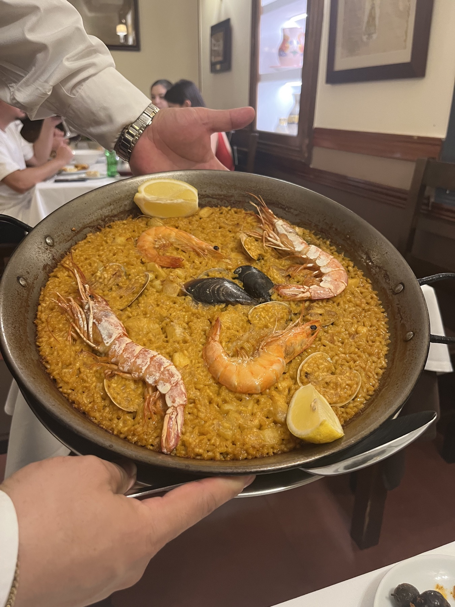
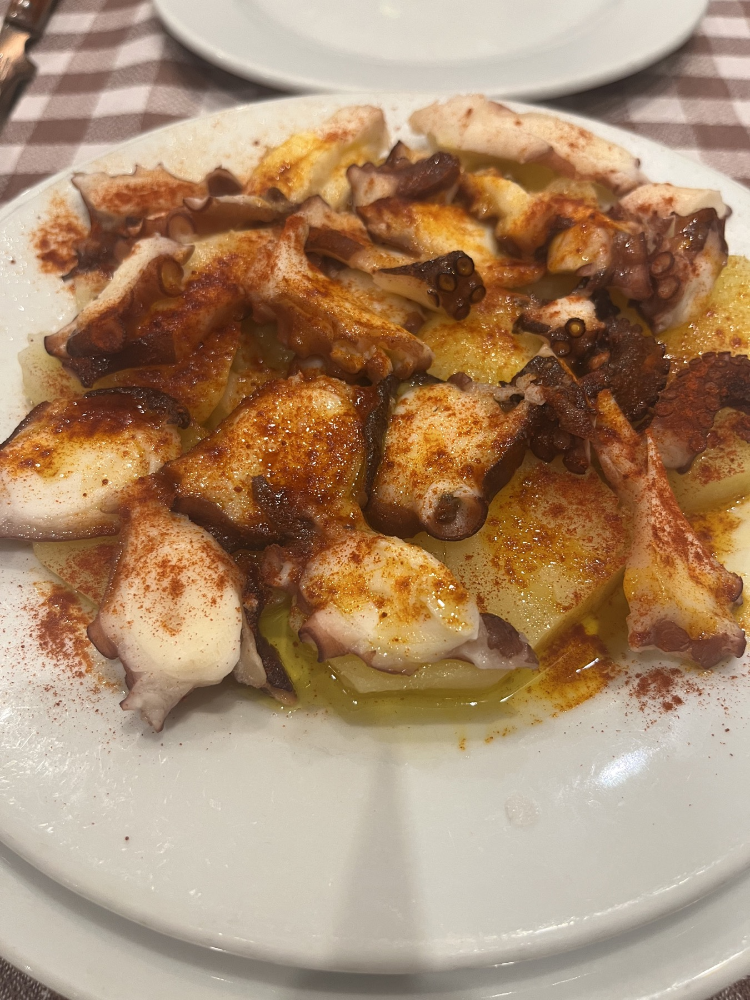
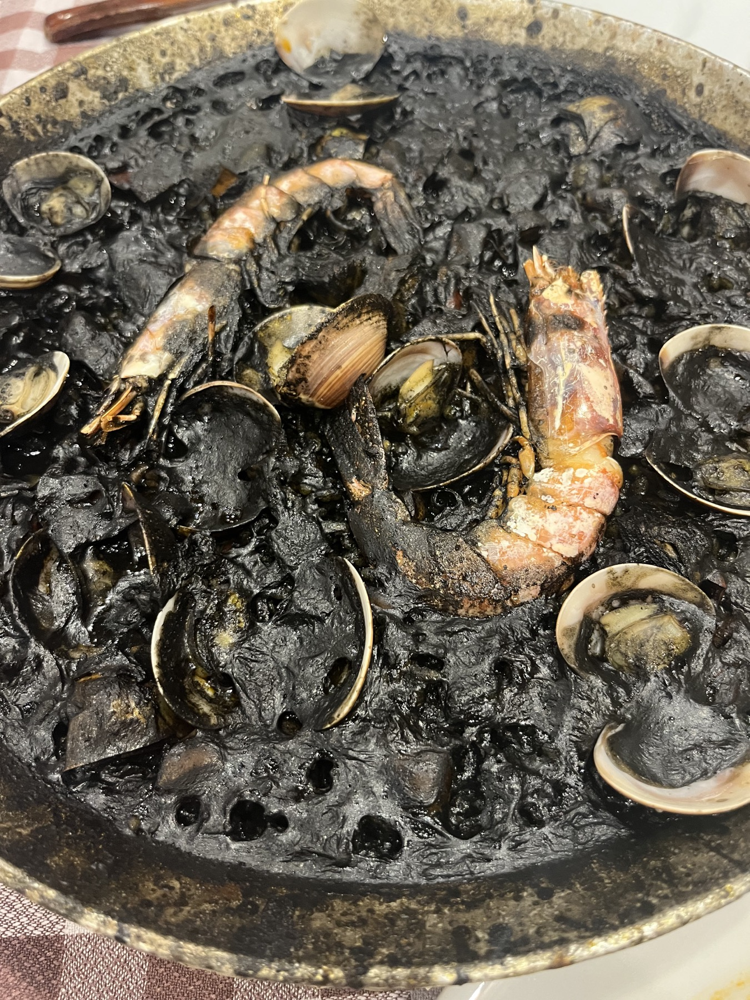
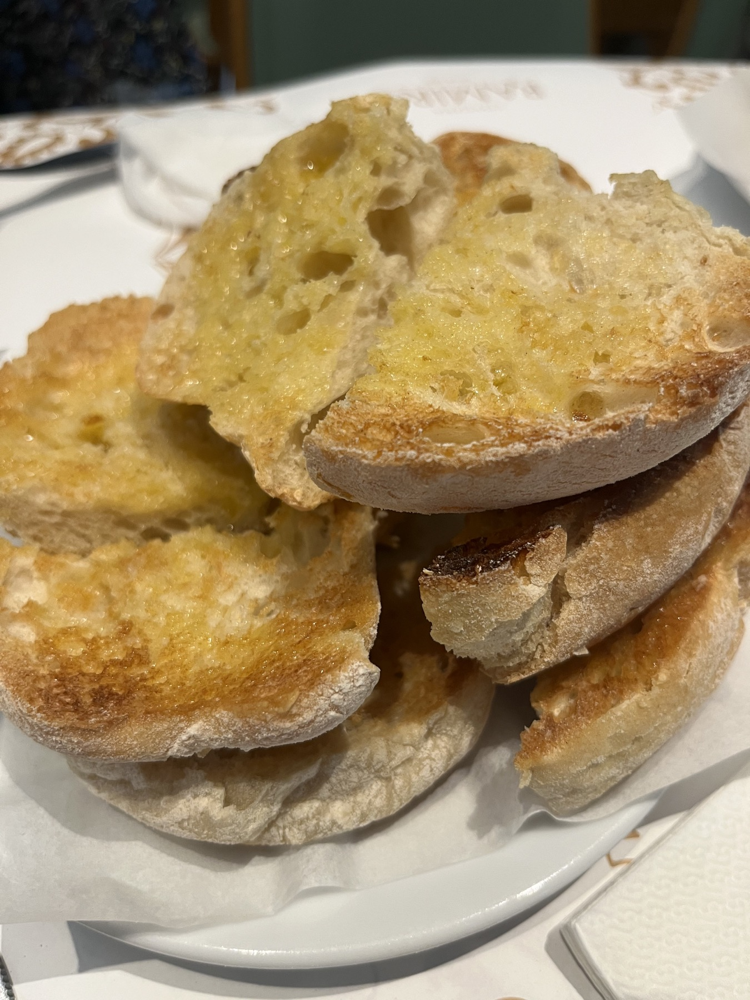
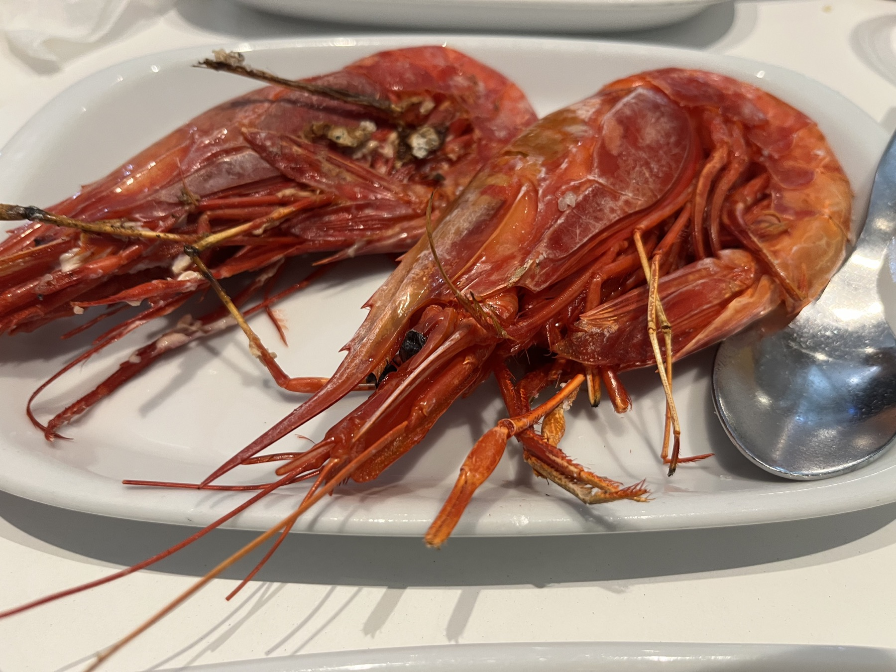
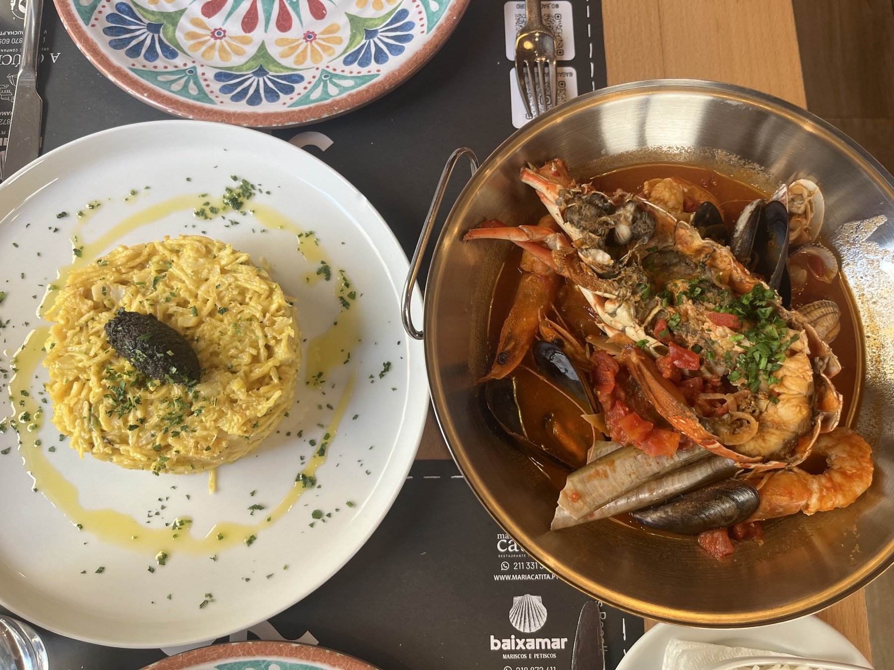

## 初の学会発表

6月末から7月にかけてポルトガルのリスボンで1週間開催された World Congress of Environmental and Resource Economists (WCERE) で共著論文を発表してきた。これは4年に毎に開催される世界大会で、1700人くらいが参加していたらしい。ヨーロッパの研究機関に所属している人が大半で、米国からは若手の著名な研究者も参加していたが、超大御所の参加はほぼなかったように思われる。

自分はこれまでちゃんとした学会で発表したことがなかったので、このかなりデカい学会が初で最初緊張していたが、知り合いとも話せたり、同僚が彼らの共著者を紹介してくれたりして、充実した初学会になった。

日本人の人も数名見かけて、何名かとは話すこともできた。ただ、アジア人の参加者の中でも中国人とインド人はかなり多く、日本人はギリ二桁いるくらいという感じだったと思う。

会場の Nova School of Business and Economics は民間の資金がかなり投入されている大学らしく、施設の充実度は高かった。キャンパスから徒歩3分でビーチにも着く。学会で提供される食事の質もサービスもかなり高く、場所とサービスの意味でこれ以上豪華な学会は少なくともヨーロッパでは開催できないのでは、と思わされた。

::: {layout-ncol=3}
{fig-alt="リスボン滞在中の写真1"}

{fig-alt="リスボン滞在中の写真2"}

{fig-alt="リスボン滞在中の写真3"}
:::

## 数量空間モデルの Summer School 

ヨーロッパのいくつかの大学は毎年夏に Summer School を開催している（お金儲けのためとよく聞く）。代表的なのが PSE, BSE, CEMFI のプログラム。[^summer-school]

[^summer-school]: ある大学では、外部の大学から先生を呼ばず、すべて自分の学部の先生が教えていて、教員が追加の収入を得る場になっているとか……。あくまで人づてに聞いた話だが。

私はマドリードの CEMFI が開催していた数量空間モデル (Quantitative Spatial Models, QSM) の Summer School に参加してきた。内容については検索したらすぐ出てくるので割愛するが、クラスメイトと一緒にご飯を食べたり飲みに行ったりもし、同じ都市・空間経済学や環境経済学に関心を持っている人とも知り合うことができ、非常に有意義な時間を過ごすことができた。講義の内容はまあまあ高度で、私の理解度は半分くらいだったが、今後の研究に活かせる知識を得ることができた。

QSMはざっくり言えば貿易・都市・空間経済学で発展してきた構造推定。過去15年くらいで大きく発展した手法・分野であり、現在研究を取り巻く環境的にも、今後発達してくことは間違いないと思われる。

::: {layout-ncol=3}
{fig-alt="スペイン滞在中の写真1"}

{fig-alt="スペイン滞在中の写真2"}

{fig-alt="スペイン滞在中の写真3"}
:::

## PhD学生の研究費・お金事情

これらのイベントに参加するためにはそこそこのお金がかかる。今回は両方の参加で日本円では40-50万円くらい掛かっている。これらは全て自分の研究費、学部の研究費と指導教官の研究費から負担して貰っている。（週末も現地に残り遊ぶのに必要な費用は当然自費だが。）

ヨーロッパの大学と言えば主語がデカすぎるし、国によっても国の中でもかなり差があるとは思うが、知っている限り、こちらの多くの大学では日本の大学よりもこれらのサポートも充実しているように思われるので、今後PhD進学・留学を考えている人は、これらの差も考慮してみるのもいいかもしれない。

PhDの給料などの経済状況についてはまた別途記事を書きたい。
